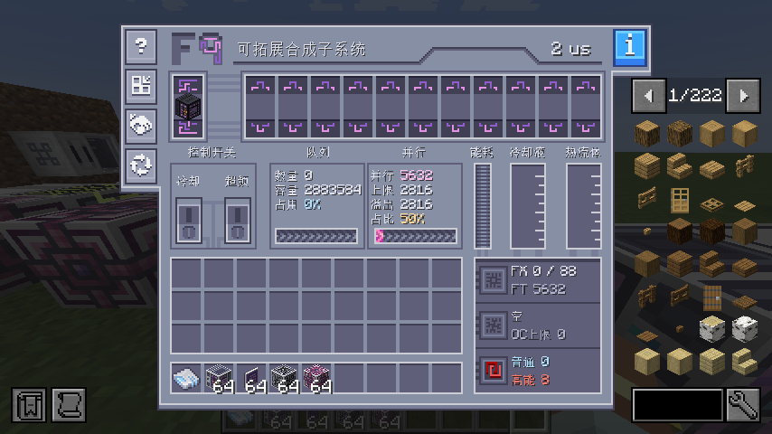
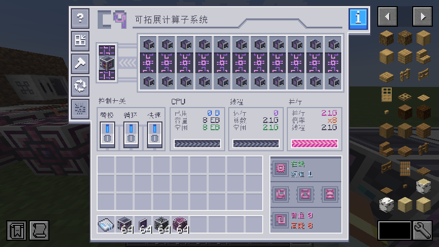
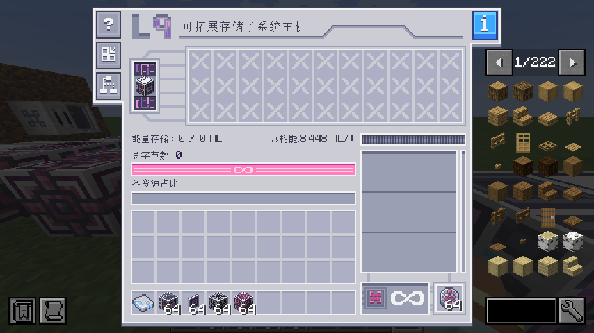
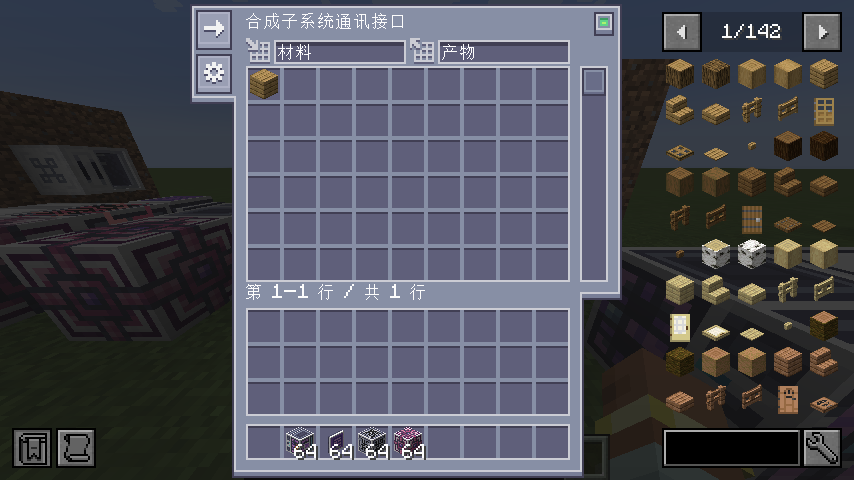
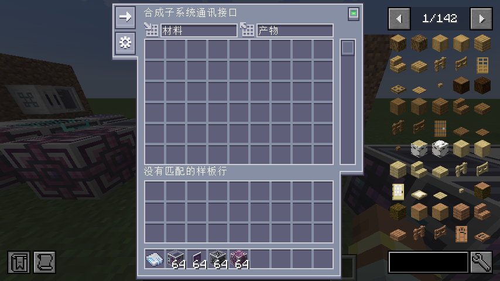

# ECO 紧凑主机界面实机验证

环境：Minecraft 1.21.1、NeoForge 21.1.251、ECO 21.2.9、AE2 19.2.18、LDLib2 2.2.40，包含 AE2 Pattern Disk 等开发环境扩展。

实机游戏截图与行为测试通过：C9、F9、L9 普通主机页面正常打开；F9 潜行右键打开通讯接口；原生编码合成样板可从背包拿起、放入概览、取出并放回背包，关闭重开后列表与实际槽位一致。插入后服务端鼠标物品为空、概览显示样板；取出后服务端鼠标持有样板、概览槽位为空。

样板验收范围：AE2 原生合成样板，配方为橡木原木 → 4 个橡木木板。截图直接保存自运行中的游戏客户端帧缓冲。

| 页面 | 实机截图 |
| --- | --- |
| 紧凑 F9：原主机 UI 与 9 级上下并行核心纹理 |  |
| 紧凑 C9：原主机 UI 与 9 级上、中、下硬件纹理 |  |
| 紧凑 L9：原存储主机 UI |  |
| F9 通讯接口：放入样板，重开后仍可读取 |  |
| F9 通讯接口：取出样板并放回背包 |  |

构建与单测通过；新版 ECO 的面板状态回归覆盖 9 级纹理、镜像单元格、动态仪表保留及未成形状态。原声明依赖 ECO 21.2.0 编译、单测与打包通过，新版面板尚不存在时跳过对应测试。
